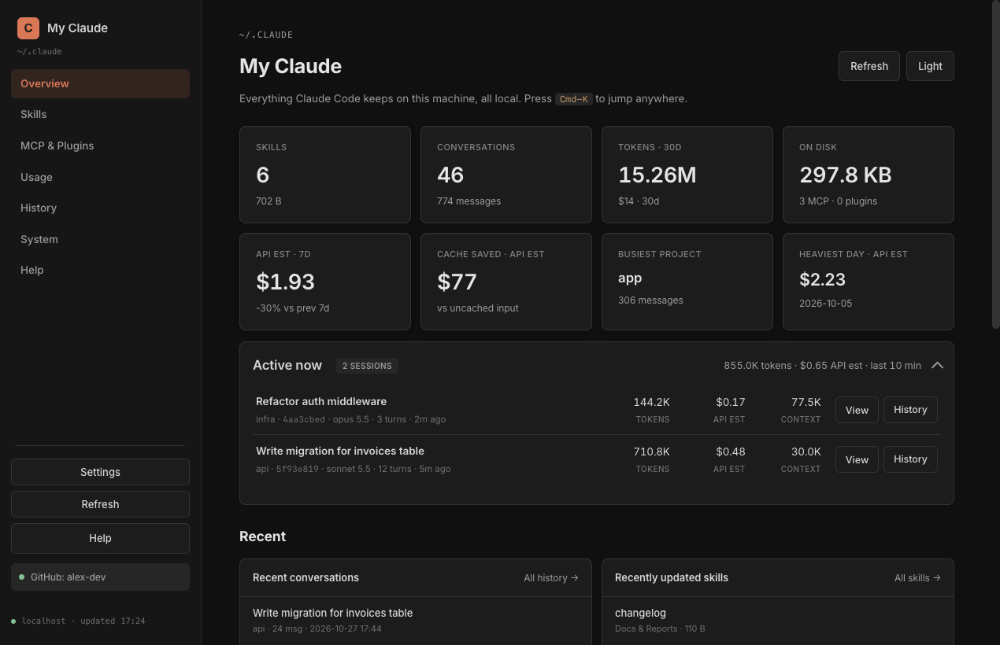

# My Claude

A local dashboard for everything Claude Code keeps in `~/.claude`: your conversations, token usage, skills, MCP servers, settings and memory. It runs on your Mac and reads your files there.

**Website:** https://my-claude.pages.dev · **Demo with sample data:** https://my-claude.pages.dev/demo.html



## Install

Paste this into Terminal:

```bash
curl -fsSL --retry 5 --retry-all-errors https://my-claude.pages.dev/install.sh | bash
```

It opens the dashboard at **http://127.0.0.1:8766** (or the next free port).

- **Needs:** macOS and Python 3.
- **First run** takes about 20 seconds while it sets up. If the browser says "This site can't be reached", wait a few seconds and refresh.
- **Read the script first** if you like: [`install.sh`](install.sh).

## What you can do

| Page | What it shows |
|---|---|
| **Overview** | Key numbers, conversations running now, recent conversations and skills, disk use |
| **Usage** | Your live plan limits, what used the current window, a pace forecast, tokens by day and model, cache cost after pauses, sub-agent use, a year-in-review card, export to CSV/JSON, totals from your other Macs |
| **History** | Every conversation with its real title, full-text search, a custom date range, rename and tag, compaction points, a sub-agent timeline, resume in your terminal, export to Markdown, and how long Claude Code keeps conversations |
| **Skills** | Every skill with use counts, most used, largest, never used, a reader for `SKILL.md`, push to GitHub or share as a zip |
| **MCP & Plugins** | Each server's health, its tools and how often you call them, and an on/off switch per project |
| **System** | The settings Claude Code actually uses (each key explained), hooks and whether they fail, disk use per folder, `CLAUDE.md` with its edit history, and memory |

**Hide names** (under Settings in the sidebar) blurs titles, paths and messages so you can share a screenshot.

## Privacy

Your transcripts never leave your Mac. The server only listens on `127.0.0.1`.

These are the only network requests, and what each one sends:

| Request | When | What it sends |
|---|---|---|
| Your plan limits from `api.anthropic.com` | While the Usage page is open, or every 10 minutes if you turn on alerts | Your Claude Code login token from the macOS keychain, nothing else |
| A health check to each MCP server's URL | When you open MCP & Plugins | A plain request, no data |
| Pushing a skill to your GitHub | Only when you click Push | That skill's files, through your own `gh` login |
| Chart, font and image libraries from public CDNs | When a page loads | Nothing of yours |

Secrets in MCP configs are hidden before they're shown.

## Where it keeps its own data

| Folder | What's in it |
|---|---|
| `~/.my-claude` | The app. Reinstalling replaces it. |
| `~/.config/my-claude` | Your names and tags, transcript backups, memory history, imported machines. Reinstalling keeps it. |

It only changes Claude Code's own files when you ask it to: how long conversations are kept and `CLAUDE.md` (in `~/.claude`), an MCP server's on/off switch (in `~/.claude.json`), and cleaning debug logs (moved to the Trash). It backs up a file before changing it.

## If something goes wrong

| Problem | Fix |
|---|---|
| The install command fails to download | Use the GitHub copy: `curl -fsSL https://chethanbhatbs.github.io/my-claude/install.sh \| MY_CLAUDE_BASE=https://chethanbhatbs.github.io/my-claude bash` |
| The page doesn't load right after install | Wait a few seconds and refresh. The first run is still setting up. |
| Port 8766 is busy | It picks the next free port and opens that one. |

**Install by hand:** download [`my-claude-dashboard.zip`](https://my-claude.pages.dev/my-claude-dashboard.zip), unzip it, run `./run.sh`.

**Remove it:** `rm -rf ~/.my-claude ~/.config/my-claude`

## For developers

The app's code is in [`app/`](app/). Run the tests with `cd app && python3 -m pytest tests -q` after `pip install -r requirements-dev.txt`. `build-bundle.sh` builds the zip that the installer downloads.

## License

MIT. Built with Claude Code.
