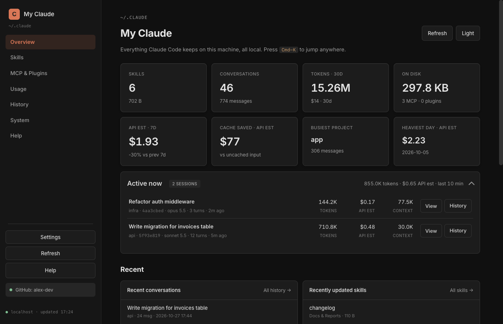

# My Claude

A local dashboard for everything Claude Code keeps in `~/.claude`: your conversations, token usage, skills, MCP servers, settings and memory. It runs on your Mac and reads your files there.

**Website:** https://my-claude.pages.dev · **Demo with sample data:** https://my-claude.pages.dev/demo.html



## Install

**You need:** a Mac and Python 3. To check, open Terminal and run `python3 --version`. If it prints a version, you're set. If not, install Python from [python.org](https://www.python.org/downloads/macos/).

1. **Open Terminal.** Press `Cmd + Space`, type `Terminal`, press Enter.
2. **Paste this and press Enter:**

   ```bash
   curl -fsSL --retry 5 --retry-all-errors https://my-claude.pages.dev/install.sh | bash
   ```

3. **Wait for the window.** Setup takes about 20 seconds. Then the **My Claude** window opens and shows "Starting…" while it reads your conversations for the first time. With a lot of history this first read can take several minutes; later starts take seconds.
4. **Keep it in the Dock** (optional). Right-click the My Claude icon in the Dock → **Options** → **Keep in Dock**.

That's it. You don't need the command again. My Claude is in your **Applications** folder and starts by itself when you log in.

| Later | How |
|---|---|
| Open it | Applications → **My Claude**, or click it in the Dock |
| Update to the newest version | Run the same command again. Your names, tags, backups and settings are kept |
| Remove it | Run `~/.my-claude/macos/uninstall.sh` in Terminal. Add `--all` to also delete your data |

You can [read the install script](install.sh) before running it. On Linux the command runs it in your browser at http://127.0.0.1:8766 instead of its own window (not tested on Linux yet).

## What you can do

| Page | What it shows |
|---|---|
| **Overview** | Key numbers, conversations running now, recent conversations and skills, disk use |
| **Usage** | Your live plan limits, what used the current window, a pace forecast, tokens by day and model, cache cost after pauses, sub-agent use, a year-in-review card, export to CSV/JSON, totals from your other Macs |
| **History** | Every conversation with its real title, full-text search, a custom date range, rename and tag, compaction points, a sub-agent timeline, resume in your terminal, export to Markdown, and how long Claude Code keeps conversations |
| **Skills** | Every skill with use counts, most used, largest, never used, a reader for `SKILL.md`, push to GitHub or share as a zip |
| **MCP & Plugins** | Each server's health, its tools and how often you call them, and an on/off switch per project |
| **System** | The settings Claude Code actually uses (each key explained), hooks and whether they fail, disk use per folder, `CLAUDE.md` with its edit history, and memory |

**Hide names** (under Settings in the sidebar) blurs titles, paths and messages so you can share a screenshot.

## Privacy

Your transcripts never leave your Mac. The server only listens on `127.0.0.1`.

These are the only network requests, and what each one sends:

| Request | When | What it sends |
|---|---|---|
| Your plan limits from `api.anthropic.com` | While the Usage page is open, or every 10 minutes if you turn on alerts | Your Claude Code login token from the macOS keychain, nothing else |
| A health check to each MCP server's URL | When you open MCP & Plugins | A plain request, no data |
| Pushing a skill to your GitHub | Only when you click Push | That skill's files, through your own `gh` login |
| Chart, font and image libraries from public CDNs | When a page loads | Nothing of yours |

Secrets in MCP configs are hidden before they're shown.

## Where it keeps its own data

| Folder | What's in it |
|---|---|
| `~/.my-claude` | The program. Reinstalling replaces it. |
| `/Applications/My Claude.app` and `~/Library/LaunchAgents/dev.myclaude.server.plist` | The app, and the login item that keeps it running (Mac only). |
| `~/.config/my-claude` | Your names and tags, transcript backups, memory history, imported machines. Reinstalling keeps it. |

It only changes Claude Code's own files when you ask it to: how long conversations are kept and `CLAUDE.md` (in `~/.claude`), an MCP server's on/off switch (in `~/.claude.json`), and cleaning debug logs (moved to the Trash). It backs up a file before changing it.

## If something goes wrong

| Problem | Fix |
|---|---|
| The install command fails to download | Use the GitHub copy: `curl -fsSL https://chethanbhatbs.github.io/my-claude/install.sh \| MY_CLAUDE_BASE=https://chethanbhatbs.github.io/my-claude bash` |
| The page doesn't load right after install | Wait a few seconds and refresh. The first run is still setting up. |
| Port 8766 is busy | It picks the next free port and opens that one. |
| The app says it did not start | Its log is `~/Library/Logs/my-claude.log`. Running the install command again usually fixes it. |

**Install by hand:** download [`my-claude-dashboard.zip`](https://my-claude.pages.dev/my-claude-dashboard.zip), unzip it, run `./run.sh`.


## For developers

The app's code is in [`app/`](app/). Run the tests with `cd app && python3 -m pytest tests -q` after `pip install -r requirements-dev.txt`. `build-bundle.sh` builds the zip that the installer downloads.

## License

MIT. Built with Claude Code.
